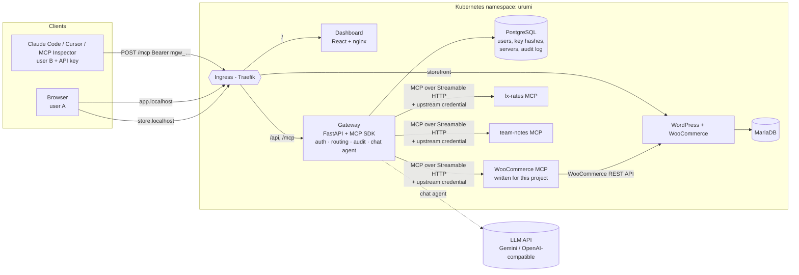

# Urumi MCP Gateway: WooCommerce hosting with a team MCP gateway on Kubernetes

An admin connects MCP servers **once** in a dashboard. Every team member then uses **all of them** through
**one MCP endpoint** (from Claude Code, Cursor, MCP Inspector…) and through a **chat agent** in the dashboard.
The first data source is a WooCommerce store running in the same cluster, exposed through an MCP server written
for this project.

Everything runs on Kubernetes and installs with **one Helm chart**. Local (k3d) and production (k3s VPS) differ
only by a values file.



Only the **Ingress** is public. The MCP servers, databases and WordPress Service are `ClusterIP` only, and
**NetworkPolicies** (default-deny) allow exactly the arrows above. Nothing except the gateway can call an
upstream MCP server.

---

## What is implemented

| Area | Requirement | Where |
|---|---|---|
| Store | WordPress + WooCommerce on K8s, persistent DB + content, COD checkout | `deploy/helm/woocommerce-store`, `services/store` |
| WooCommerce MCP | Written for this project, Streamable HTTP, `list_products`, `get_product`, `create_product`, `list_orders`, `get_order`, `update_order_status`, internal-only | `services/woocommerce-mcp` |
| Gateway | Add / edit / disable / remove upstreams with optional bearer or header credential | `services/gateway/app/api/servers.py` |
| | One MCP endpoint; list = all enabled servers' tools; calls routed to the right server | `services/gateway/app/upstreams.py`, `mcp_endpoint.py` |
| | Name collisions → `<server>__<tool>` prefix scheme | [docs/ARCHITECTURE.md](docs/ARCHITECTURE.md#tool-names-and-collisions) |
| | Slow/dead upstream isolated: cached discovery, per-call timeout, clear errors | [docs/ARCHITECTURE.md](docs/ARCHITECTURE.md#timeouts-and-dead-upstreams) |
| | Upstream credentials never reach the browser or MCP clients (Fernet-encrypted at rest) | `security.py`, `schemas.py` |
| | 3 upstreams: WooCommerce, fx-rates, team-notes (+ add any public MCP server by URL) | `services/demo-upstreams` |
| Team | admin / member roles, invites, per-user API keys (hashed, revocable), audit log in dashboard | `api/members.py`, `api/keys.py`, `api/audit.py` |
| Chat agent | LLM tool loop through the gateway as the logged-in user; shows tool calls | `services/gateway/app/agent.py` |
| K8s | Helm only, values-local / values-prod, Ingress with stable hosts, probes + requests/limits everywhere, Secrets | `deploy/helm/urumi-platform` |
| Extras | Tool permissions (admin-only tools hidden + rejected), SSRF protection, default-deny NetworkPolicies, non-root containers, no SA tokens, credential encryption with key rotation, multi-replica gateway, per-user rate limit, Prometheus metrics, CI | see [docs/SECURITY.md](docs/SECURITY.md) |

Not implemented: the optional **multi-store provisioning** bonus. The store is already a self-contained,
reusable chart (`woocommerce-store`: WordPress + MariaDB + its own MCP server + its own NetworkPolicies), which
is the building block that feature would install once per store.

---

## Quick start (local, macOS / Linux)

**Prerequisites:** Docker (Docker Desktop with ≥ 6 GB memory, or OrbStack), `k3d`, `kubectl`, `helm`, `python3`.
```bash
brew install k3d kubectl helm          # macOS
```

```bash
git clone <this repo> && cd urumi-mcp-gateway
make hosts        # one-time: maps store.localhost + app.localhost to 127.0.0.1 (sudo)
make up           # k3d cluster -> build 5 images -> import -> helm install  (~5-10 min first time)
```
`make up` ends by printing the dashboard and WordPress admin passwords. Then open:

| URL | What |
|---|---|
| http://store.localhost | Storefront (add to cart → checkout with **Cash on delivery**) |
| http://store.localhost/wp-admin | WooCommerce admin (orders) |
| http://app.localhost | Dashboard: servers, team, keys, audit log, chat |
| http://app.localhost/mcp | **The** MCP endpoint (needs `Authorization: Bearer <your key>`) |

**Enable the chat agent.** Pick one free provider.

| Provider | Setup | Notes |
|---|---|---|
| **Groq** (recommended, fastest) | key from https://console.groq.com/keys, then `bash scripts/use-groq.sh gsk_...` | `openai/gpt-oss-20b`, falls back to `gpt-oss-120b` / `qwen3.8-27b` |
| **Gemini** (default in values.yaml) | key from https://aistudio.google.com/apikey, then `make llm-secret KEY=...` | `gemini-2.5-flash-lite` with thinking off, falls back to other Flash models |

Any other OpenAI-compatible API (OpenAI, OpenRouter, Ollama) works via `llm.provider=openai`, `llm.baseUrl`,
`llm.model`. Free tiers get busy, so the agent switches to a fallback model **immediately** on 429/5xx/retired
model errors and only then reports a clear "try again" message. Every answer shows a timing line
(total · model · AI time · tool time), which shows the gateway + tools take ~0.1 s and the rest is the LLM.

**Connect Claude Code as a team member:** generate a key on *API Keys*, then
```bash
claude mcp add --transport http urumi-gateway http://app.localhost/mcp --header "Authorization: Bearer mgw_..."
```

**Verify everything:** `make e2e` runs the definition-of-done checks (two users, revoke, disable, audit).

Useful: `make status`, `make logs`, `make passwords`, `make down`.

### Local domain approach
`*.localhost` names point at `127.0.0.1`. k3d maps host ports 80/443 to its load balancer, which forwards to
Traefik (the Ingress controller bundled with k3s). Traefik routes by `Host` header: `store.localhost` → WordPress,
`app.localhost` → dashboard + gateway. Browsers resolve `*.localhost` on their own, and `make hosts` adds
the two names to `/etc/hosts` so CLI tools (curl, Claude Code, Python) resolve them as well. Inside the
cluster, WordPress gets a `hostAliases` entry so it can reach its own URL (WP-Cron).

---

## Production-like VPS (k3s)

Same chart, different values file: `values-prod.yaml` sets real domains + TLS (cert-manager), GHCR images,
`existingSecret`s created out of band, 2 gateway replicas and storage sizes.
Step by step: **[docs/DEPLOY_VPS.md](docs/DEPLOY_VPS.md)**.

---

## Repository layout

```
services/
  store/              WordPress+WooCommerce image + idempotent setup script (WP-CLI)
  woocommerce-mcp/    the WooCommerce MCP server (Python, MCP SDK, Streamable HTTP)
  demo-upstreams/     fx-rates and team-notes MCP servers (upstreams #2 and #3)
  gateway/            FastAPI backend: MCP endpoint, upstream manager, REST API, chat agent
  dashboard/          React + Vite + TypeScript SPA (served by non-root nginx)
deploy/helm/
  woocommerce-store/  reusable chart: one store + its MCP server + its NetworkPolicies
  urumi-platform/     umbrella chart: gateway, dashboard, Postgres, upstreams, Ingress, policies
scripts/e2e_check.py  definition-of-done checks against a running deployment (repeatable: new member each run)
scripts/use-groq.sh   switch the chat agent to Groq (values-groq.yaml overlay)
docs/                 architecture, security, Kubernetes, demo script, VPS deploy, learning guide
```

## Documentation

* [docs/ARCHITECTURE.md](docs/ARCHITECTURE.md): components, how a tool call travels, MCP internals, collisions, timeouts, chat agent
* [docs/SECURITY.md](docs/SECURITY.md): keys, credentials, roles, malicious upstreams, SSRF, network isolation
* [docs/KUBERNETES.md](docs/KUBERNETES.md): what runs where, Secrets, volumes, Ingress, probes, upgrades and rollback
* [docs/DEMO_SCRIPT.md](docs/DEMO_SCRIPT.md): the definition-of-done demo, step by step, with two users
* [docs/DEPLOY_VPS.md](docs/DEPLOY_VPS.md): local → production story
* [docs/LEARNING_GUIDE.md](docs/LEARNING_GUIDE.md): beginner-friendly explanation of every concept + interview Q&A

## Tests

```bash
make test     # 34 tests: gateway (real HTTP upstreams, SSRF, permissions, timeouts, chat loop, LLM failover) + WooCommerce MCP
```
CI (`.github/workflows/ci.yml`) runs the tests, builds the dashboard, lints and schema-validates the Helm chart
for both environments, and builds multi-arch images (pushed to GHCR on `main` and tags).
